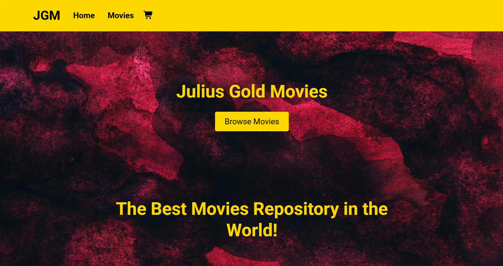

</> Markdown

## React Film App Screenshot



## 🛠️ Tech Stack

* React — User interface development.  
* REST API — Communication with web services through REST endpoints.

### 🚀 Key Features

*  📚 Dynamic Film Search & Discovery: Enables users to search and browse movies with dynamically loaded film data for an engaging discovery experience.
*  ⚡ Seamless Navigation & Routing: Implements dynamic routing to provide smooth navigation between movie listings and individual film details.
*  🎯 Responsive, Reusable Components: Features reusable movie card components with responsive layouts for a consistent browsing experience across desktop, tablet, and mobile devices.

## React Film App

🔗 **Live Demo:** [View Live Website](https://final-react-movies-projectcrimsongo.vercel.app/)

A React application that allows users to search for movies.

## React Film App Run Instructions

A movie browsing application built with React and JavaScript. The application is organized into reusable UI components and pages for exploring movies, viewing movie information, and managing a shopping cart.

## Prerequisites

Before installing the project, ensure that the following software is installed on your computer.

### 1. Install Node.js

Node.js provides the JavaScript runtime required to run the development server and build the application.

Download and install Node.js from the official website:

https://nodejs.org/

Choose an appropriate supported LTS version for your project.

After installation, open your terminal and verify that Node.js and npm are available:

```bash
node -v
npm -v
```

Both commands should display version numbers.

If either command fails, restart your terminal and check that Node.js was added to your system's PATH.

### 2. Install Git

Git is recommended for cloning the repository and managing project changes.

Download Git from:

https://git-scm.com/downloads

Verify the installation:

```bash
git --version
```

If you already downloaded the project as a ZIP file, you can skip Git installation for now.

### 3. Install a Code Editor

Visual Studio Code is recommended for editing and running the project.

Download it from:

https://code.visualstudio.com/

## Local Installation and Setup

Follow these steps to install and run the React Film App on your computer.

### Step 1: Get the Project

Clone your repository using Git:

```bash
git clone YOUR_REPOSITORY_URL
```

Replace `YOUR_REPOSITORY_URL` with your actual Git repository URL.

Navigate into the project directory:

```bash
cd YOUR_PROJECT_FOLDER
```

Replace `YOUR_PROJECT_FOLDER` with the actual folder name created when you cloned the repository.

**Alternatively:** If you downloaded the project as a ZIP file, extract it and open the extracted project folder in Visual Studio Code.

### Step 2: Open the Project in Visual Studio Code

If you are already inside the project directory, run:

```bash
code .
```

Alternatively, open Visual Studio Code manually and select **File → Open Folder**, then choose the React Film App project directory.

Ensure that the project root contains these files:

```text
React-Film-App/
├── public/
├── src/
├── package.json
├── package-lock.json
└── README.md
```

### Step 3: Install Dependencies

Open the integrated terminal in Visual Studio Code by selecting:

**Terminal → New Terminal**

Ensure that the terminal is positioned in the project root directory, where `package.json` is located.

Run:

```bash
npm install
```

This command installs the dependencies declared in `package.json`.

Because the project includes `package-lock.json`, you can also use the following command for a reproducible installation when the lockfile is synchronized with `package.json`:

```bash
npm ci
```

Use `npm ci` for a clean installation when you do not need to preserve changes to installed dependencies. It removes the existing `node_modules` directory before installing the locked dependencies.

If installation fails, review the error message before trying another command.

### Step 4: Configure Environment Variables

If the application uses a REST API that requires an API key or base URL, configure the necessary environment variables before starting the application.

Create a file named `.env` in the project root, alongside `package.json`.

Example for a Create React App project:

```env
REACT_APP_API_BASE_URL=https://api.example.com
REACT_APP_API_KEY=your_api_key_here
```

**Important:**

* Replace the example URL with the actual REST API endpoint used by the application.
* Replace the placeholder API key with a valid key if your API requires one.
* Do not commit secret credentials to a public repository.
* Environment variable names must match those referenced in your source code.
* For Create React App, browser-accessible custom environment variables must begin with `REACT_APP_`.
* If your project uses Vite instead, custom client-side variables normally use the `VITE_` prefix and are accessed through `import.meta.env`.

The supplied project structure does not identify the API provider or confirm that an API key is required. Check `src/data.js`, `src/App.js`, and `package.json` to determine the actual configuration.

If the application does not use environment variables, you can skip this step.

After changing environment variables, restart the development server.

### Step 5: Start the Development Server

For a standard Create React App project, run:

```bash
npm start
```

The development server should start, and the application will usually be available at:

http://localhost:3000

If the browser does not open automatically, copy the address into your browser.

Keep the terminal running while you use the application. To stop the development server, press:

```text
Ctrl + C
```

**Note:** The command `npm start` assumes that your `package.json` defines a `start` script. If it does not, inspect the available scripts before proceeding.

## Running the Project in Production Mode

A production build creates optimized static files that can be deployed to a compatible web server or hosting platform.

### Step 1: Build the Application

For a standard Create React App project, run:

```bash
npm run build
```

The production build will normally be generated in a directory named:

```text
build/
```

This directory contains the optimized application files.

If the build fails, review the terminal output and fix any compilation errors before deploying.

### Step 2: Preview or Test the Production Build

Create React App does not provide a universal built-in production preview command.

You can use a static server to serve the generated files locally. For example, with Node.js and npm installed, run:

```bash
npx serve -s build
```

If prompted to install the `serve` package, review the prompt and approve it if appropriate.

The terminal will display the local address where the production build is being served.

Open that address in your browser to test the production version.

This command is a local preview method, not a replacement for deploying the application to a production hosting service.

### Step 3: Deploy the Application

After confirming that the production build works, deploy the generated static files to a hosting platform that supports React single-page applications.

Examples include:

* GitHub Pages
* Netlify
* Vercel

Configure the hosting platform to serve the generated build output and redirect application routes to `index.html` if your routing setup requires it.

**Important:** If the application fetches data from an external REST API, verify that the deployed site can reach the API and that the API permits requests from your deployed domain.

## Available npm Commands

For a standard Create React App project, the following commands are commonly available:

| Command         | Description                                                               |
| --------------- | ------------------------------------------------------------------------- |
| `npm install`   | Installs project dependencies.                                            |
| `npm ci`        | Performs a clean dependency installation using the lockfile.              |
| `npm start`     | Starts the development server.                                            |
| `npm run build` | Creates an optimized production build.                                    |
| `npm test`      | Runs the configured test suite.                                           |
| `npm run eject` | Exposes the underlying build configuration in a Create React App project. |

The commands listed above depend on the scripts defined in `package.json`. Check your project's actual scripts before using them.

**Warning:** The `npm run eject` command is generally irreversible. Do not run it unless you understand why you need to expose and manage the underlying build configuration.

To inspect your available npm scripts, run:

```bash
npm run
```

## Troubleshooting

### 1. `npm` Is Not Recognized

**Possible cause:** Node.js is not installed correctly, or npm is missing from your system's PATH.

**Solution:**

1. Install or reinstall a supported Node.js LTS release.
2. Close and reopen your terminal.
3. Verify the installation:

```bash
node -v
npm -v
```

### 2. Missing Module or Dependency Errors

Example:

```text
Module not found: Error: Can't resolve 'some-package'
```

**Possible causes:**

* Dependencies have not been installed.
* A required package is missing from `package.json`.
* An import path is incorrect.
* The imported file does not exist at the specified location.

**Solution:**

First, install the declared dependencies:

```bash
npm install
```

If the error refers to a local file or image, verify that the file exists and that the import path is correct.

For example, assets stored in `public/assets/` can generally be referenced in JSX using paths such as:

```jsx

```

For filenames containing spaces, use the exact filename and URL-encode spaces if needed:

```jsx

```

Alternatively, rename asset files to simpler names without spaces and update their references.

### 3. The Development Server Will Not Start

**Possible causes:**

* Dependencies are missing.
* Port 3000 is already in use.
* A compilation error prevents the application from starting.
* The project does not define a `start` script.

**Solution:**

Check the available scripts:

```bash
npm run
```

Then review the terminal output for the specific error.

If port 3000 is already in use, you may be prompted to run the application on another available port.

### 4. Movie Data Is Not Displaying

**Possible causes:**

* The REST API endpoint is incorrect.
* The API key is missing or invalid.
* The network request is failing.
* The API response has a different structure than the application expects.
* The API has rate limits or access restrictions.

**Solution:**

1. Open your browser's Developer Tools.
2. Select the **Network** tab.
3. Reload the application.
4. Inspect the API requests and their HTTP status codes.
5. Check the Console tab for JavaScript errors.
6. Verify the endpoint, API configuration, and expected response structure.

If the API requires a key, ensure that it is configured correctly.

Never place private server-side credentials in client-side React code. Environment variables embedded in a browser build are not secret.

### 5. Movie Images Are Not Displaying

**Possible causes:**

* The image filename is incorrect.
* The image is stored in a different directory.
* The path contains spaces or special characters.
* The API returns an invalid or unavailable image URL.

**Solution:**

Check that the file exists in the expected directory.

For an image stored in `public/assets/`, use a root-relative path:

```jsx

```

For an image stored inside `src/`, use a suitable relative import:

```jsx
import backgroundImage from "./components/images/backgroundjpeg.jpg";
```

Adjust the relative path to match the location of the component importing the image.

### 6. Environment Variables Are Not Working

**Possible causes:**

* The variable name does not match the name used in the code.
* The `.env` file is in the wrong directory.
* The variable uses the wrong prefix for the build tool.
* The development server was not restarted.

**Solution:**

1. Confirm that `.env` is in the project root.
2. Check the variable names against the source code.
3. Verify whether the project uses Create React App or Vite.
4. Restart the development server.

For Create React App, a variable might be accessed as follows:

```javascript
const apiUrl = process.env.REACT_APP_API_BASE_URL;
```

For Vite, a variable might instead be accessed as follows:

```javascript
const apiUrl = import.meta.env.VITE_API_BASE_URL;
```

Use only the approach appropriate for your project's build tool.

### 7. Changes Are Not Appearing in the Browser

**Solution:**

1. Save your files.
2. Check the terminal for compilation errors.
3. Refresh the browser.
4. If necessary, restart the development server.

For persistent display issues, clear the browser cache or perform a hard refresh.

### 8. The Production Build Fails

Run:

```bash
npm run build
```

Review the error output and check for:

* Incorrect import paths.
* Missing dependencies.
* Undefined variables.
* Invalid JSX syntax.
* Case mismatches in filenames.
* Missing environment variables.

Fix the reported issues and rebuild the application.

## Project Structure

```text
React-Film-App/
├── public/
│   ├── assets/
│   │   ├── movie posters and images
│   │   └── other static assets
│   ├── index.html
│   ├── favicon.ico
│   └── manifest.json
├── src/
│   ├── components/
│   │   ├── images/
│   │   ├── pages/
│   │   │   ├── Cart.jsx
│   │   │   ├── Home.jsx
│   │   │   ├── MovieInfo.jsx
│   │   │   └── Movies.jsx
│   │   └── ui/
│   │       ├── Discounted.jsx
│   │       ├── Explore.jsx
│   │       ├── Featured.jsx
│   │       ├── Footer.jsx
│   │       ├── Highlight.jsx
│   │       ├── Highlights.jsx
│   │       ├── Landing.jsx
│   │       ├── Movie.jsx
│   │       ├── Nav.jsx
│   │       ├── Price.jsx
│   │       └── Rating.jsx
│   ├── App.js
│   ├── data.js
│   ├── index.css
│   ├── index.js
│   └── logo.svg
├── package.json
├── package-lock.json
└── README.md
```

## Contributing

Contributions and suggestions are welcome.

To contribute:

1. Fork the repository.
2. Create a feature branch.
3. Make your changes.
4. Test the application.
5. Submit a pull request describing your changes.

## Getting Started with Create React App

This project was bootstrapped with [Create React App](https://github.com/facebook/create-react-app).

## Available Scripts

In the project directory, you can run:

### `npm start`

Runs the app in the development mode.\
Open [http://localhost:3000](http://localhost:3000) to view it in your browser.

The page will reload when you make changes.\
You may also see any lint errors in the console.

### `npm test`

Launches the test runner in the interactive watch mode.\
See the section about [running tests](https://facebook.github.io/create-react-app/docs/running-tests) for more information.

### `npm run build`

Builds the app for production to the `build` folder.\
It correctly bundles React in production mode and optimizes the build for the best performance.

The build is minified and the filenames include the hashes.\
Your app is ready to be deployed!

See the section about [deployment](https://facebook.github.io/create-react-app/docs/deployment) for more information.

### `npm run eject`

**Note: this is a one-way operation. Once you `eject`, you can't go back!**

If you aren't satisfied with the build tool and configuration choices, you can `eject` at any time. This command will remove the single build dependency from your project.

Instead, it will copy all the configuration files and the transitive dependencies (webpack, Babel, ESLint, etc) right into your project so you have full control over them. All of the commands except `eject` will still work, but they will point to the copied scripts so you can tweak them. At this point you're on your own.

You don't have to ever use `eject`. The curated feature set is suitable for small and middle deployments, and you shouldn't feel obligated to use this feature. However we understand that this tool wouldn't be useful if you couldn't customize it when you are ready for it.

## Learn More

You can learn more in the [Create React App documentation](https://facebook.github.io/create-react-app/docs/getting-started).

To learn React, check out the [React documentation](https://reactjs.org/).

### Code Splitting

This section has moved here: [https://facebook.github.io/create-react-app/docs/code-splitting](https://facebook.github.io/create-react-app/docs/code-splitting)

### Analyzing the Bundle Size

This section has moved here: [https://facebook.github.io/create-react-app/docs/analyzing-the-bundle-size](https://facebook.github.io/create-react-app/docs/analyzing-the-bundle-size)

### Making a Progressive Web App

This section has moved here: [https://facebook.github.io/create-react-app/docs/making-a-progressive-web-app](https://facebook.github.io/create-react-app/docs/making-a-progressive-web-app)

### Advanced Configuration

This section has moved here: [https://facebook.github.io/create-react-app/docs/advanced-configuration](https://facebook.github.io/create-react-app/docs/advanced-configuration)

### Deployment

This section has moved here: [https://facebook.github.io/create-react-app/docs/deployment](https://facebook.github.io/create-react-app/docs/deployment)

### `npm run build` fails to minify

This section has moved here: [https://facebook.github.io/create-react-app/docs/troubleshooting#npm-run-build-fails-to-minify](https://facebook.github.io/create-react-app/docs/troubleshooting#npm-run-build-fails-to-minify)
# final-react-movies-project
